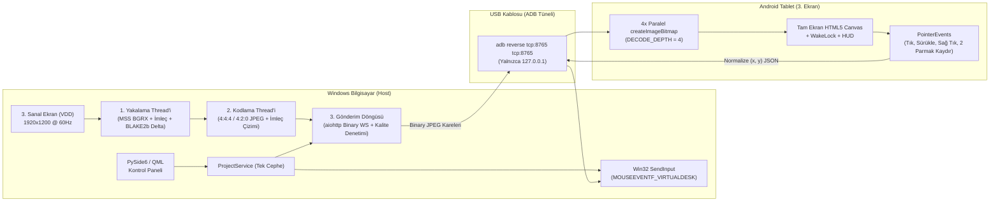

# TabScreen USB — Android Tableti USB ile 3. Ekran Olarak Kullanma Aracı


**TabScreen USB**, Windows bilgisayarınız (**1. Ekran:** Harici Ana Monitör, **2. Ekran:** Laptop Ekranı) ile Android tabletiniz arasında **yalnızca USB kablosu üzerinden**, üçüncü taraf bulut veya telemetri sunucularına hiçbir veri göndermeden **%100 yerel (`127.0.0.1` loopback)** çalışan, dokunmatik ve fare imleci destekli bir **3. Ekran (Genişletilmiş Masaüstü / Extended Display)** yazılımıdır.

---

## İçindekiler
1. [Neden Bu Proje?](#1-neden-bu-proje)
2. [Sistemin Çalışma Mantığı (Uçtan Uca Mimari)](#2-sistemin-çalışma-mantığı-uçtan-uca-mimari)
   - [2.1. 3 Ekranlı Sanal Masaüstü Topolojisi](#21-3-ekranlı-sanal-masaüstü-topolojisi)
   - [2.2. USB ADB Reverse Tüneli (`127.0.0.1` Loopback)](#22-usb-adb-reverse-tüneli-127001-loopback)
   - [2.3. Üç Aşamalı Asenkron Yayın Boru Hattı (Pipeline)](#23-üç-aşamalı-asenkron-yayın-boru-hattı-pipeline)
   - [2.4. Otomatik Kip (Durulunca Keskinleştirme) ve Paralel Çözme](#24-otomatik-kip-durulunca-keskinleştirme-ve-paralel-çözme)
   - [2.5. 3. Ekrana Özel Dokunmatik ve Fare Enjeksiyonu](#25-3-ekrana-özel-dokunmatik-ve-fare-enjeksiyonu)
3. [Katmanlı Kod Mimarisi ve QML Arayüzü](#3-katmanlı-kod-mimarisi-ve-qml-arayüzü)
4. [Kurulum ve Hızlı Başlangıç](#4-kurulum-ve-hızlı-başlangıç)
5. [Komut Satırı (CLI) ve Geliştirici Komutları](#5-komut-satırı-cli-ve-geliştirici-komutları)
6. [Gizlilik ve Güvenlik İlkeleri](#6-gizlilik-ve-güvenlik-ilkeleri)

---

## 1. Neden Bu Proje?

Ticari ikinci ekran yazılımları (örn. Spacedesk vb.) kapalı kaynaklı sürücüler kurar, arka planda sistem servisleri çalıştırır ve ağ/ekran verilerinin nasıl işlendiği denetlenemez. Bu proje:
- **Tamamen Şeffaf ve Yereldir:** Kaynak kodu açıktır; sunucu yalnızca `127.0.0.1` (localhost) üzerinde açılır, yerel Wi-Fi ağınıza (`0.0.0.0`) veya internete **hiçbir paket göndermez**.
- **Durağan Ekranda ~%0 CPU Tüketir:** Kod okurken, doküman incelerken veya terminal izlerken ekran değişmediği sürece kare sıkıştırması ve veri aktarımı yapılmaz.
- **Tablette Ekstra Uygulama (APK) Kurulumu Gerektirmez:** USB tüneli üzerinden tabletin kendi modern tarayıcısında (Chrome/Brave/Edge) donanım hızlandırmalı HTML5 `<canvas>`, `Screen WakeLock` ve `PointerEvents` ile tam ekran çalışır.

---

## 2. Sistemin Çalışma Mantığı (Uçtan Uca Mimari)



### 2.1. 3 Ekranlı Sanal Masaüstü Topolojisi
Windows'ta fiziksel olarak **1. Ekran** (Ana Monitör) ve **2. Ekran** (Laptop) bağlıdır. Tabletin bağımsız bir **3. Ekran** olabilmesi için açık kaynaklı **Virtual Display Driver (`Root\MttVDD`)** ile işletim sisteminde `1920x1200` (16:10 tablet oranı) çözünürlüğünde sanal bir 3. monitör oluşturulur ve Windows **"Masaüstünü bu ekrana genişlet (Extend)"** kipine geçirilir.

### 2.2. USB ADB Reverse Tüneli (`127.0.0.1` Loopback)
Ağ gecikmesini ve Wi-Fi güvenlik risklerini ortadan kaldırmak için Android Debug Bridge (`adb.exe`) kullanılır:
- `adb -s <seri_no> reverse tcp:8765 tcp:8765` komutu, tablet üzerindeki `127.0.0.1:8765` portunu doğrudan USB kablosu içinden Windows'un `127.0.0.1:8765` portuna bağlar.
- Böylece hem Windows sunucusu hem de tablet tarayıcısı yalnızca `127.0.0.1` ile konuşur.

### 2.3. Üç Aşamalı Asenkron Yayın Boru Hattı (Pipeline)
Görüntü yakalama, sıkıştırma ve ağ gönderimi birbirini beklememesi için **3 ayrı aşamaya** bölünmüştür:
1. **Aşama 1 — Yakalama (`ScreenCapturer.acquire`):**
   - `mss` kütüphanesiyle hedef ekranın `BGRX` ham piksel tamponu doğrudan belleğe alınır (gereksiz RGB kopyalaması yapılmaz).
   - `mss` donanımsal fare imlecini yakalamadığı için Win32 `GetCursorPos` ile küresel fare konumu okunur; imleç 3. ekran sınırları içindeyse ekran içi `(rel_x, rel_y)` koordinatı hesaplanır.
   - **Satır Tabanlı BLAKE2b Delta İmzası:** Her 8. satırın tam genişliği ve imleç konumu `BLAKE2b` ile özetlenir. Küçük bir terminal imleci yanıp sönmesi veya fare hareketi bile anında algılanır; hiçbir değişiklik yoksa kare sıkıştırma aşamasına hiç girmeden atlanır.
2. **Aşama 2 — Kodlama (`ScreenCapturer.encode`):**
   - Ayrı bir işçi iş parçacığında (`ThreadPoolExecutor`) `N.` kare JPEG'e kodlanırken, yakalama iş parçacığı `N+1.` kareyi yakalar.
   - İmleç 3. ekrandaysa görüntünün üzerine net bir Windows ok imleci (`draw_cursor_pointer`) çizilir.
3. **Aşama 3 — Gönderim ve Bağlantıya Duyarlı Kalite (`StreamServer._sender_loop`):**
   - Ağ/USB kuyruğunda henüz gönderilmemiş eski bir kare varsa yeni kare onun üzerine yazar (**en yeni kare kazanır / latest-wins**).
   - Atılan kare oranı (`frames_dropped`) `%15`'i aşarsa `next_quality_penalty` devreye girerek JPEG kalitesini kademeli olarak (en fazla 15 birim) düşürür ve USB 2.0 bant genişliği (~16–26 MB/sn) sınırında akıcılığı korur; hat rahatladığında kaliteyi saniyede 1 birim geri yükseltir.

### 2.4. Otomatik Kip (Durulunca Keskinleştirme) ve Paralel Çözme
Uygulama 3 görüntü kipi sunar:
- **Otomatik Kip (`auto` - Varsayılan):** Ekran hareket halindeyken (pencere sürükleme, kaydırma, video) `4:4:4` `q85` (40 FPS) akıcı kareler gönderir. Ekran `0.2 saniye` (`SETTLE_SEC`) boyunca durulduğunda tek bir **`q92` (en yüksek keskinlikte `4:4:4`)** kare gönderir ve tekrar hareket olana kadar trafiği sıfırlar (1 sn hareketsizlikten sonra yoklama hızı `15 FPS`'e iner).
- **Okuma / Kod Kipi (`reading`):** Renkli terminal ve IDE metinlerinin alt-piksel netliği için `4:4:4` (`subsampling=0`, `q92`, `30 FPS`) kullanır.
- **Video Kipi (`video`):** Yüksek hareketli içerikler için `4:2:0` (`subsampling=2`, `q70`, `45 FPS`) kullanır.
- **Tablette 4-Derinlikli Paralel Çözme (`DECODE_DEPTH = 4`):** Tablet tarayıcısı gelen Binary WebSocket karelerini tek tek beklemek yerine aynı anda 4 adet `createImageBitmap(blob)` görevini paralel çalıştırarak çok çekirdekli mobil işlemciyi tam kullanır ve çözülen kareleri sıra numarasıyla (`seq`) `<canvas>` yüzeyine çizer.

### 2.5. 3. Ekrana Özel Dokunmatik ve Fare Enjeksiyonu
Tabletteki `<canvas>` üzerinde gerçekleşen `PointerEvents` etkileşimleri normalize edilmiş `(0.0 .. 1.0)` koordinatlara dönüştürülür:
- Windows tarafında [`map_touch_to_desktop`](src/core/input_injector.py) fonksiyonu bu noktayı yalnızca **seçili 3. ekranın** sanal masaüstü koordinatlarına (`monitor.left + x * width`, `monitor.top + y * height`) ve ardından Win32 `MOUSEEVENTF_VIRTUALDESK | MOUSEEVENTF_ABSOLUTE` (`0..65535`) uzayına haritalar.
- **Desteklenen Hareketler:**
  - **Tek Dokunuş / Sürükleme:** Sol tık (`down`, `move`, `up`) ve pencere taşıma.
  - **Uzun Basma (520 ms):** Sağ tık (`right_tap`).
  - **İki Parmak Dikey Hareket:** Fare tekerleği kaydırma (`scroll` / `MOUSEEVENTF_WHEEL`).

---

## 3. Katmanlı Kod Mimarisi ve QML Arayüzü

Proje, `test_layering.py` AST bekçi testiyle zorunlu kılınan **tek yönlü 3 katmanlı** mimariye sahiptir (`core` → `services` → `ui`):

```text
P029-Tablet_Ekrani_Kullanimi/
├── main.py                         # Giriş noktası (PySide6/QML Arayüzü veya --cli kipi)
├── baslat.bat                      # Konsolsuz (pythonw.exe) masaüstü başlatıcısı
├── 3_ekran_kur.bat                 # Sanal 3. Ekran (Root\MttVDD) tek tık kurulum betiği
├── 3_ekran_kaldir.bat              # Sanal 3. Ekran kaldırma betiği
├── src/
│   ├── version.py                  # Sürüm tek kaynak (Single Source of Truth)
│   ├── core/                       # Alt Katman (services ve ui import ETMEZ)
│   │   ├── logging_config.py       # İdempotent RotatingFileHandler (1MB x 3) + excepthook
│   │   ├── app_settings.py         # MODE_PRESETS ve UTF-8 JSON ayar kalıcılığı
│   │   ├── display_manager.py      # Çoklu ekran (1, 2, 3) topoloji tespiti ve VDD yönetimi
│   │   ├── adb_manager.py          # Güvenli adb.exe tespiti ve USB reverse tüneli
│   │   ├── screen_capture.py       # İki aşamalı (acquire/encode) yakalama ve imleç çizimi
│   │   └── input_injector.py       # Win32 SendInput dokunmatik -> fare enjektörü
│   ├── services/                   # Orta Katman (ui import ETMEZ)
│   │   ├── stream_server.py        # Loopback korumalı aiohttp Binary WebSocket sunucusu
│   │   └── project_service.py      # Arayüz ve CLI için Tek Cephe (Facade) servisi
│   └── ui/                         # Üst Katman (yalnızca ProjectService cephesini kullanır)
│       ├── controller_app.py       # PySide6 QObject ViewModel (ControllerViewModel) ve QThread işçileri
│       ├── qml/
│       │   └── Main.qml            # Modern, responsive, WCAG AA ve klavye erişilebilir QML arayüzü
│       └── client_assets/
│           └── index.html          # Android tablet tam ekran HTML5 Canvas istemcisi
├── docs/wiki/                      # Bağlantılı LLM Wiki bilgi tabanı (index, architecture, decisions, log...)
└── tests/                          # Birim, güvenlik, QML yerleşim/erişilebilirlik ve AST bekçi testleri
```

---

## 4. Kurulum ve Hızlı Başlangıç

### 4.0. Hazır Kurulum (Önerilen): `TabScreenUSB-Setup-X.Y.Z.exe`

[Releases](https://github.com/Yusufygc/Tableti_Yan_Ekran_Kullanmak/releases/latest) sayfasından **`TabScreenUSB-Setup-X.Y.Z.exe`** dosyasını indirip çalıştırın. Kurulum yönetici izni istemez (`%LOCALAPPDATA%\Programs\TabScreenUSB`), adb ve sanal ekran sürücüsü (VDD) paketle birlikte gelir; kullanıcı verisi (`~\.tabscreen_usb`) kaldırıcı tarafından silinmez.

- Kurulum dosyasının SHA-256 özeti aynı sayfadaki `.sha256` dosyasındadır.
- **Kurulum dosyası imzasızdır.** SmartScreen "Windows bilgisayarınızı korudu" derse *Ek bilgi → Yine de çalıştır* seçin. Windows 11 *Akıllı Uygulama Denetimi* açıksa ve dosyayı engellerse bu seçenek çıkmaz: birkaç dakika sonra aynı dosyayı yeniden çalıştırın ya da yeni sürümü indirin (SAC'ı kapatmanızı önermeyiz).
- **Güncelleme:** uygulama açılışta yeni sürüm arar (tek istek: `api.github.com`, kimlik bilgisi yok). *Güncelle* denince dosya indirilir, boyutu ve SHA-256 özeti doğrulanır, kurulum sessizce yapılır ve uygulama kendiliğinden yeniden açılır. Kapatmak için panelde *Açılışta güncellemeleri denetle* kutusunu kaldırın ya da `TABSCREEN_NO_UPDATE_CHECK=1` ortam değişkenini kullanın.

### 4.1. Kaynaktan Çalıştırma (Geliştirici)

1. **Android Tablette USB Hata Ayıklamayı Açın:**
   - Tabletinizin *Ayarlar > Tablet Hakkında > Yazılım Bilgileri > Yapım Numarası* satırına **7 kez** dokunarak *Geliştirici Seçenekleri*ni açın.
   - *Geliştirici Seçenekleri > USB Hata Ayıklama (USB Debugging)* seçeneğini etkinleştirin ve tableti USB kablosuyla bilgisayara bağlayın (tablette çıkan izin penceresinde *"Her zaman izin ver"*i onaylayın).
2. **3. Sanal Ekranı Etkinleştirin:**
   - Uygulama içindeki **"3. Sanal Ekranı Kur (VDD)"** düğmesine tıklayın veya `3_ekran_kur.bat` dosyasını çalıştırıp Yönetici (UAC) onayına *Evet* deyin.
   - Windows `1920x1200` boyutunda 3. ekranı oluşturup masaüstünü bu ekrana genişletecektir.
3. **Uygulamayı Başlatın:**
   - **`baslat.bat`** dosyasına çift tıklayın.
   - Açılan QML kontrol panelinde **"2) Yayını Başlat (127.0.0.1:8765)"** düğmesine tıklayın.
   - Uygulama USB tünelini otomatik kuracak, yayını başlatacak ve **tabletinizin tarayıcısında `http://127.0.0.1:8765` sayfasını otomatik olarak açacaktır**.
4. **Tam Ekran Kullanım:**
   - Tablette sağ üstteki kontrol çubuğundan **"Tam Ekran"** düğmesine dokunun. Kontrol çubuğunu küçültmek için solundaki yeşil **"Ekran 3"** rozetine dokunabilirsiniz.

---

## 4.2. Sürüm Yayınlama ve Exe Üretimi (Geliştirici)

```powershell
# Yerelde kurulum dosyası üret (exe kapısı + exe denemesi + Inno + .sha256 + sessiz kurulum denemesi)
.env\Scripts\python.exe build_installer.py        # -> dist\installer\TabScreenUSB-Setup-X.Y.Z.exe

# Yeni sürüm: src/version.py + README rozeti + commit + ek açıklamalı etiket (itmez)
.env\Scripts\python.exe tools/release.py 0.2.0
git push origin main
git push origin v0.2.0       # etiketi itmek herkese güncelleme penceresi çıkarır; --follow-tags KULLANMA
```

Ayrıntı: `docs/wiki/exe-dagitim-rehberi.md` (kararlı exe, Akıllı Uygulama Denetimi), `docs/wiki/surum-yayinlama.md`, `docs/wiki/guncelleme-sistemi.md`. Simgeler `packaging/icons/make_icons.py` ile üretilir (16-512 px PNG + çok çerçeveli `app.ico`).

---

## 5. Komut Satırı (CLI) ve Geliştirici Komutları

Arayüz olmadan doğrudan terminalden başlatmak için:
```powershell
.\venv\Scripts\python.exe main.py --cli --monitor 3 --mode auto
```

Geliştirici doğrulama komutları (her değişiklik sonrası çalıştırılır):
```powershell
# 1. Lint kontrolü (ruff E9, F)
.\venv\Scripts\python.exe -m ruff check .

# 2. Birim, QML ve AST bekçi testleri (UTF-8 kodlama uyarısı hata modunda)
.\venv\Scripts\python.exe -X warn_default_encoding -m pytest -v

# 3. Bağımlılık güvenlik taraması
.\venv\Scripts\python.exe -m pip_audit -r requirements.txt
```

---

## 6. Gizlilik ve Güvenlik İlkeleri

- **Sıfır Dış Ağ İsteği:** Uygulama hiçbir dış sunucuya bağlanmaz, analitik veya telemetri toplamaz. Tablet istemcisi (`index.html`) hiçbir dış CDN, font veya betik yüklemez (`test_tablet_html_accessibility_and_offline_readiness` ile denetlenir).
- **Loopback ve Origin Koruması (`loopback_guard_middleware`):** Sunucu yalnızca `127.0.0.1` / `localhost` adreslerinde başlatılabilir. Gelen her HTTP ve WebSocket isteğinde `Host` ve `Origin` başlıkları doğrulanır; tarayıcı üzerinden yapılabilecek çapraz kaynak (CSRF / DNS rebinding) saldırıları `403 Forbidden` ile reddedilir.
- **Tek İstemci Politikası:** Aynı anda yalnızca tek bir tablet oturumu akışı alabilir; yeni bir bağlantı geldiğinde eski oturum `4001` koduyla güvenli şekilde kapatılır.
- **Otomatik Temizlik:** Uygulama kapatıldığında hem yerel yayın sunucusu durdurulur hem de `adb reverse --remove` ile USB port yönlendirmesi temizlenir.
